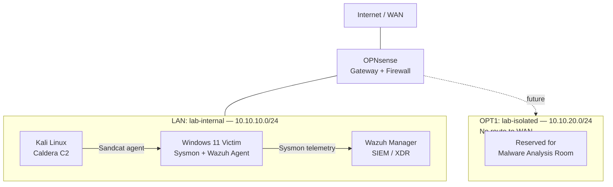

# Home SOC Lab

A self-built Security Operations Center lab for hands-on practice in detection engineering, threat hunting, adversary emulation, and home network monitoring. Built from the ground up on Oracle VirtualBox, with every component deployed, networked, and troubleshot manually rather than from a pre-built template.

## Goals

- Build a realistic, segmented lab environment to practice detection and threat hunting
- Gain hands-on experience deploying and operating a SIEM (Wazuh)
- Practice red-team/blue-team exercises using real adversary emulation tooling
- Eventually extend the lab to monitor my actual home network
- Build toward malware analysis in an isolated environment

## Architecture

| Component | Role | Details |
|---|---|---|
| OPNsense | Gateway / firewall | Segments the lab into a LAN (`lab-internal`, 10.10.10.0/24) and an isolated OPT1 network (`lab-isolated`, 10.10.20.0/24) reserved for future malware analysis, with no route to WAN |
| Wazuh (v4.14.7) | SIEM / XDR manager | Central log collection, agent management, and alerting; dashboard for investigating detections |
| Windows 11 (victim endpoint) | Monitored endpoint | Sysmon with the SwiftOnSecurity configuration for high-fidelity telemetry, enrolled as a Wazuh agent |
| Kali Linux | Attacker / red team | Runs MITRE Caldera for structured adversary emulation against the Windows endpoint |

All VMs run on Oracle VirtualBox, originally built on a 16GB desktop and later migrated in full to a dedicated 64GB lab laptop to remove the resource constraints of the early build.

## Build phases

1. **Foundations** — planning the architecture and network segmentation
2. **OPNsense** — gateway and firewall deployment, LAN/OPT1 segmentation
3. **Wazuh** — SIEM manager deployment, dashboard access, agent infrastructure
4. **Windows victim endpoint** — Sysmon deployment (SwiftOnSecurity config), Wazuh agent enrollment
5. **Kali + Caldera** — adversary emulation platform deployment, Sandcat agent deployment to the Windows endpoint, first adversary emulation run (MITRE ATT&CK Discovery techniques) validated end-to-end against Wazuh/Sysmon telemetry
6. **Planned:** isolated malware analysis room (using the `lab-isolated` segment)
7. **Planned:** detection content and threat-hunting exercises (custom Wazuh rules, MITRE ATT&CK mapping)
8. **Planned:** extending monitoring to my real home network

## Notable technical problems solved

Building this lab meant a lot of real troubleshooting beyond following a guide — this is the part I'd point to as the most representative of actual SOC/sysadmin work:

- **VirtualBox virtual disk corruption after migration.** Moving the lab to new hardware surfaced `VBOX_E_OBJECT_NOT_FOUND` errors from mismatched disk UUIDs, including a broken snapshot differencing-disk chain. Diagnosed and repaired using `VBoxManage internalcommands sethduuid` / `sethdparentuuid`, verifying the fix at the binary level with `dumphdinfo` rather than trial and error.
- **Wazuh manager startup failures under resource pressure.** The manager was intermittently failing to start within systemd's timeout window. Diagnosed via `journalctl` boot-history comparison and confirmed as RAM starvation; resolved by reallocating VM memory and validating full daemon health (`wazuh-control status`) rather than papering over the symptom.
- **Agent auto-enrollment collision loop.** The Windows Wazuh agent was simultaneously holding a manually-issued key and attempting auto-enrollment, creating duplicate/conflicting agent registrations on the manager that never resolved to "active." Traced to the agent's default auto-enrollment behaviour, fixed by explicitly disabling enrollment in `ossec.conf` and re-issuing a clean, manually-keyed agent.
- **Wazuh dashboard API outage root-caused to a stale internal cache**, not a credentials or network issue as the surface-level error suggested — traced through `api.log` and daemon status to a `wazuh-apid` health-check desync after repeated manager restarts.
- **Windows Defender blocking the red-team tooling**, diagnosed and resolved with a targeted `Add-MpPreference` exclusion rather than disabling protection wholesale.
- **Full lab migration between hosts** — moving every VM, preserving network configuration and agent state, and re-tuning resource allocation for the new hardware without rebuilding from scratch.

## Repository contents

- [`scripts/caldera-deploy-sandcat.ps1`](scripts/caldera-deploy-sandcat.ps1) — the PowerShell script used to deploy the Caldera Sandcat agent from the attacker VM onto the Windows victim endpoint for adversary emulation runs.
- Endpoint telemetry uses the public [SwiftOnSecurity Sysmon configuration](https://github.com/SwiftOnSecurity/sysmon-config) rather than a custom ruleset — credited here rather than re-hosted.

## Skills demonstrated

- Network segmentation and firewall configuration (OPNsense)
- SIEM deployment, agent lifecycle management, and dashboard administration (Wazuh)
- Endpoint telemetry engineering (Sysmon, SwiftOnSecurity ruleset)
- Adversary emulation and MITRE ATT&CK-aligned testing (Caldera)
- Linux systemd service diagnostics and log analysis (`journalctl`, daemon health checks)
- Windows administration and PowerShell scripting
- Virtualization internals (VirtualBox media registry and disk UUID management)
- Methodical incident troubleshooting — isolating root cause rather than treating symptoms

## Status

Actively in progress. Phase 5 (Kali + Caldera) is complete and validated; next up is Atomic Red Team testing on the Windows endpoint, followed by the isolated malware analysis room.

---

*Built as part of my BSc (Hons) Cyber Security Management studies, alongside independent learning on TryHackMe.*
